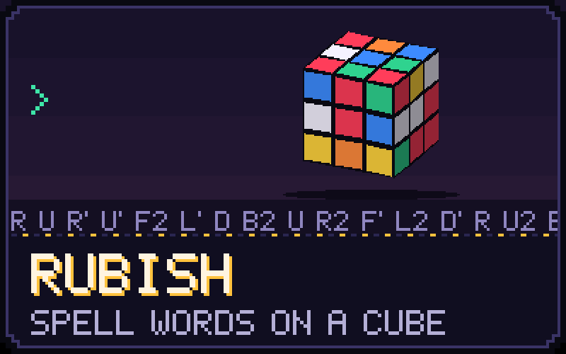
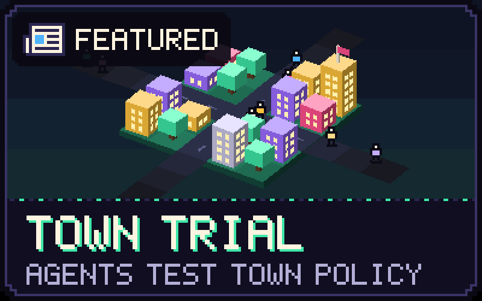

<!--
  Images in assets/ are generated, not hand-made:
  - SVGs (hero, tiles, buttons, trophies): python3 tools/build_assets.py
  - 3D GIF tiles (rubish, Town Trial, Multivis):            python3 tools/build_gifs.py
  - narrow banner + social buttons (logos in tools/logos/): python3 tools/trial_assets.py && python3 tools/build_social.py
  Edit the scripts, re-run them, and commit the new files in assets/.

  Layout rules (keep these or the edges stop lining up):
  - Every grid row spans exactly 0-100%: 32% column + 1.99% gap + 32% + 1.99% + 32%.
    Gaps are transparent spacer images, NOT spaces, so images in a row must sit on one
    line with no whitespace between them (a space's width depends on the viewer's font).
  - A Demo/Video pair is two 16% halves (tools/build_assets.py demo_button side=...).
  - Header: GitHub adds 20px padding to the inner side of align=left/right images, so
    the banner's left edge and the socials' right edge land exactly on 0% and 100%.
    Banner 76.63% / socials 8.8% keeps their heights equal and fits down to ~275px wide.
-->

  
  
   
  
   
  
   

  
   
  

  
   
  

  

  

