<!--
  Every image here is an animated pixel-art SVG generated by tools/build_assets.py.
  To change a label, colour or project: edit that script, run
  `python3 tools/build_assets.py`, and commit the new files in assets/.
-->

  

  <picture>
    <source media="(prefers-color-scheme: dark)" srcset="assets/header-projects-dark.svg">
    <source media="(prefers-color-scheme: light)" srcset="assets/header-projects-light.svg">
    
  </picture>

  
  
   
  
  

  
  
   
  
  

  
  
   
  
  

  <picture>
    <source media="(prefers-color-scheme: dark)" srcset="assets/header-trophies-dark.svg">
    <source media="(prefers-color-scheme: light)" srcset="assets/header-trophies-light.svg">
    
  </picture>

  <a href="https://github.com/SmaranKudapa/picky"><picture>
    <source media="(prefers-color-scheme: dark)" srcset="assets/award-picky-dark.svg">
    <source media="(prefers-color-scheme: light)" srcset="assets/award-picky-light.svg">
    
  </picture></a>
  <a href="https://github.com/SmaranKudapa/claimos"><picture>
    <source media="(prefers-color-scheme: dark)" srcset="assets/award-claimos-dark.svg">
    <source media="(prefers-color-scheme: light)" srcset="assets/award-claimos-light.svg">
    
  </picture></a>

  <picture>
    <source media="(prefers-color-scheme: dark)" srcset="assets/footer-dark.svg">
    <source media="(prefers-color-scheme: light)" srcset="assets/footer-light.svg">
    
  </picture>

