<!--
  Images in assets/ are generated, not hand-made:
  - SVGs (hero, tiles, buttons, headers, trophies, footer): python3 tools/build_assets.py
  - 3D GIF tiles (rubish, Town Trial, Multivis):            python3 tools/build_gifs.py
  Edit the scripts, re-run them, and commit the new files in assets/.
-->

  

  

  
  
  
   
  
  
  

  
  
  
   
  
  
  

  

  
  

  

  

