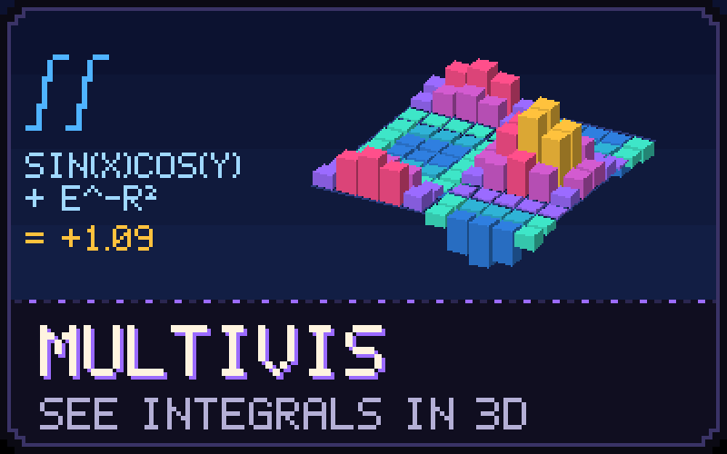

<!--
  Images in assets/ are generated, not hand-made:
  - SVGs (hero, tiles, buttons, trophies): python3 tools/build_assets.py
  - 3D GIF tiles (rubish, Town Trial, Multivis):            python3 tools/build_gifs.py
  - narrow banner + social buttons (logos in tools/logos/): python3 tools/trial_assets.py && python3 tools/build_social.py

  Layout rules (keep them or edges stop lining up):
  - Each grid row spans 0-100%: images sit on one line with NO whitespace between them;
    gaps are transparent spacer images (1.99%), Demo/Video halves are 15.5% + 0.99% + 15.5%.
  - Top row: GitHub pads align=left images by 20px on the inner side, so only the banner
    floats; the three social buttons sit in the line beside it and stack on their own.
    87.03% banner / 10.14% buttons: same height, ~24px gap (GitHub forces 20px), edge-aligned;
    measured live, the buttons stay beside the banner for READMEs >= ~750px wide (windows >= ~1200px).
    No whitespace between the banner tag and the first button.
  Edit the scripts, re-run them, and commit the new files in assets/.
-->

  
  
  
   

  
   
  

  
   
  

  

  

